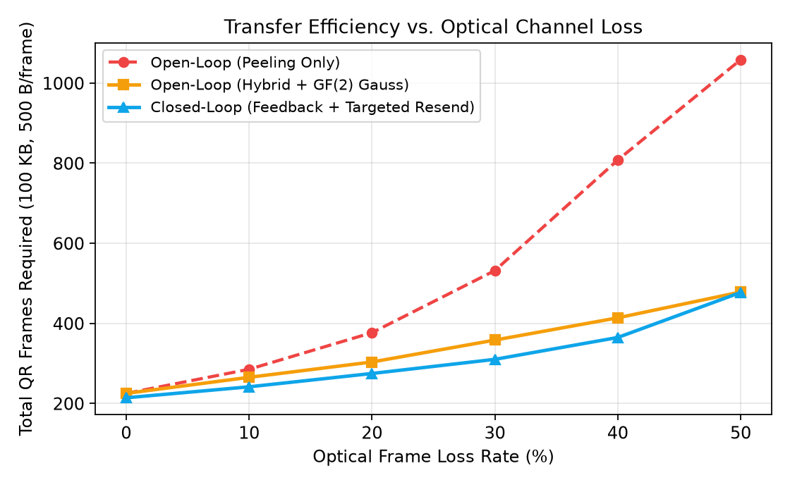
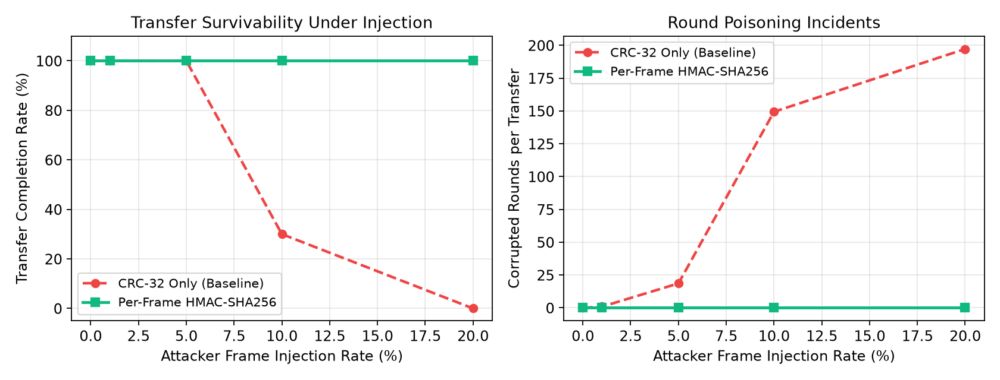
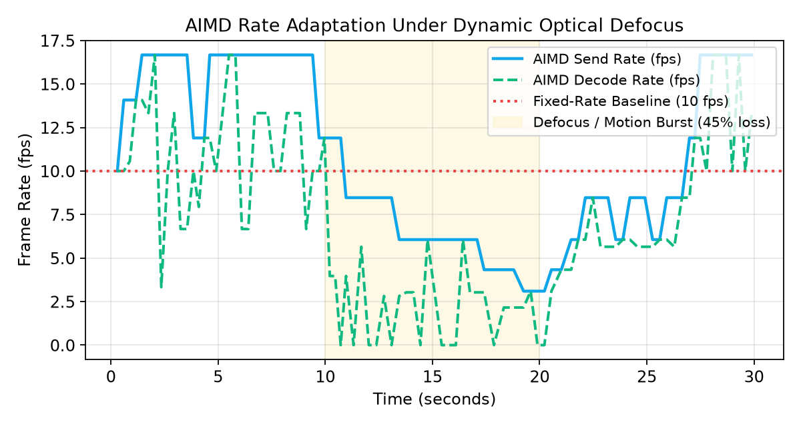
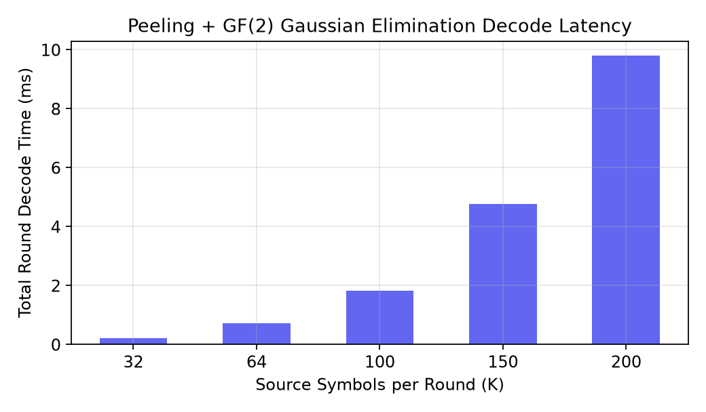

# QR-Stream

Send any file from a PC screen to a phone camera using only QR codes.
The file never touches the network; only a tiny `/feedback` control channel does (and true air-gap open-loop mode works with zero Wi-Fi).

## Features

- **Base45 + Alphanumeric QR Encoding (RFC 9285):** Carries ~29% more payload per QR than Base64 + byte mode.
- **Closed-Loop Hybrid Fountain + GF(2) Solver:** LT codes (peeling + bit-packed GF(2) Gaussian elimination fallback) paired with targeted single-block tail retransmission.
- **Spatial & Color Multiplexing:** `1×1`, `2×1` *(default)*, and `2×2` grid layouts, plus optional 3-channel RGB multiplexing and a 32-bit `Uint32Array` `ImageData` pre-renderer.
- **Zero-Copy Receiver + 3-Worker `zbar` Pool:** Uses hardware `BarcodeDetector(<video>)` when available (`0 ms` canvas readback) with a 3-worker QR-only `zbar.wasm` fallback pool.
- **Authenticated Encryption:** Optional password protection with PBKDF2-HMAC-SHA256, HKDF key separation, AES-256-GCM payload + encrypted manifest, and per-frame 64-bit HMAC-SHA256 (`VER_AUTH = 0x85`) to reject poisoned/spoofed frames.
- **Multi-MB & 100+ MB Scaling:** Supports up to 1,024 rounds via `doneRounds[]` + 30-bit `doneMask`, freeing completed round buffers continuously.
- **Live Telemetry Dashboard (`logs.html`):** Real-time scan FPS, decode latency, seed timeline, and session export.

## Run

```bash
python make_cert.py     # once: creates self-signed cert.pem / key.pem
python serve.py
```

Then open:

- **Sender (PC):** `https://localhost:8443/sender.html` — accept the one-time self-signed certificate prompt (**Advanced → Proceed**).
- **Receiver (Phone):** `https://<LAN IP printed by serve.py>:8443/receiver.html` — accept the warning once, tap **Start receiver**, and tap the QR preview to lock focus.
- **Diagnostics (`logs.html`):** `https://localhost:8443/logs.html`

## Test & Benchmarks

```bash
node tests/codec.test.js       # 40 checks: framing, HMAC/AES crypto, fountains, >35 rounds, lossy transfers
node tests/benchmark_paper.js  # full evaluation suite -> paper/results.json
node tests/sim_rounds.js       # closed-loop multi-QR simulator (1 MB - 10 MB)
node tests/bench_speed.js      # spatial & RGB throughput scaling benchmark
python tests/plot_paper.py     # generates 5 figures in paper/figures/
```

## Evaluation Highlights

| Figure | Summary |
|---|---|
|  | Closed-loop targeted tail repair completes transfers in `1.000×–1.039×` symbols across `0%–50%` optical loss. |
|  | Per-frame HMAC-SHA256 achieves `100%` completion and `0` corrupted rounds even at `20%` adversarial frame injection. |
|  | AIMD controller backs off during motion/defocus bursts and recovers smoothly when focus returns. |
|  | Bit-packed GF(2) elimination solves `K=200` stalled rounds in `< 10 ms`. |
|  | Multiplexing scales `1 MB` throughput from `4.5 KB/s` (`1×1 Mono`) to `15.4 KB/s` (`2×1 Mono`), `46.7 KB/s` (`2×2 Mono`), and `103.9 KB/s` (`2×2 RGB`). |

## Files

| Path | What |
|---|---|
| `codec.js` | Wire format, LT fountain, GF(2) solver, CRC-32, PBKDF2/HKDF/HMAC-SHA256, AES-GCM, rate control |
| `sender.html` | PC UI: file picker, 32-bit `ImageData` multi-QR renderer, feedback client, AIMD adaptation |
| `receiver.html` | Phone UI: camera + tap-to-focus lock, zero-copy `BarcodeDetector` / 3-worker `zbar`, decoder |
| `logs.html` | Real-time telemetry & seed timeline dashboard |
| `serve.py` | Threaded HTTPS server with per-thread TLS handshake, HTTP→HTTPS redirect, `/feedback`, `/telemetry`, `/metrics` |
| `vendor/` | Local `pako`, `qrcode-generator`, `zbar.wasm`, `vue`, `tailwind` (zero internet required) |
| `tests/` | Unit tests (`codec.test.js`), channel simulators (`sim.js`, `sim_rounds.js`), benchmarks & plotters |
| `paper/` | Evaluation results (`results.json`), paper outline (`PAPER_BLUEPRINT.md`), and PNG figures (`figures/`) |
