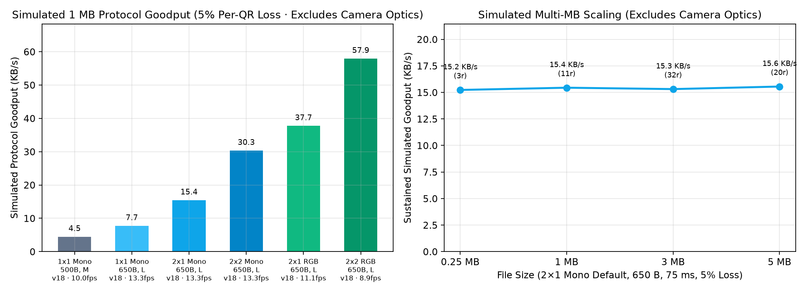

# QR-Stream

Send any file from a PC screen to a phone camera using only QR codes.
The file never touches the network; only a tiny `/feedback` control channel does (and true air-gap open-loop mode works with zero Wi-Fi).

## Features

- **Base45 + Alphanumeric QR Encoding (RFC 9285):** Uses 5.5 bits/char Alphanumeric mode instead of 8-bit Byte mode (`121.21` vs `93.75` bytes per 1,000 data bits, `+29.3%` theoretical efficiency; a `670 B` ECC-L frame fits in QR v18 `89×89` vs QR v21 `101×101` for Base64).
- **Closed-Loop Hybrid Fountain + GF(2) Solver:** LT codes (peeling + bit-packed GF(2) Gaussian elimination fallback) paired with targeted single-block tail retransmission.
- **Spatial & Color Multiplexing:** `1×1`, `2×1` *(default: `650 B`, `ECC L`, `75 ms`)*, and `2×2` grid layouts, plus experimental 3-channel RGB multiplexing and a 32-bit `Uint32Array` `ImageData` pre-renderer.
- **Zero-Copy Receiver + 3-Worker `zbar` Pool:** Uses hardware `BarcodeDetector(<video>)` when available with a 3-worker QR-only `zbar.wasm` fallback pool.
- **Authenticated Encryption:** Optional password protection with PBKDF2-HMAC-SHA256 (`600,000` iterations), HMAC-SHA256 domain-separated key derivation (`aesKey` + `macKey`), AES-256-GCM payload + encrypted manifest (`T_FILE_ENC = 0x05`), and per-frame 64-bit truncated HMAC-SHA256 (`VER_AUTH = 0x85`) to reject poisoned/spoofed frames.
- **Multi-MB & 100+ MB Scaling:** Uses `96 KB` rounds (`256 KB` rounds above `4 MB`) up to `1,024` rounds via `doneRounds[]` + 30-bit `doneMask`, freeing completed round buffers continuously.
- **Adaptive Rate Controller:** Hysteresis multiplicative controller (`RateController`, `1.4×` step across `40–180 ms`) driven by decoded-to-sent symbol ratio.
- **Live Telemetry Dashboard (`logs.html`):** Real-time scan FPS, decode latency, seed timeline, and session export.

## Run

```bash
python make_cert.py     # once: creates self-signed cert.pem / key.pem
python serve.py
```

Then open:

- **Sender (PC):** `https://localhost:8443/sender.html` — accept the one-time self-signed certificate prompt (**Advanced → Proceed**).
- **Receiver (Phone):** `https://<LAN IP printed by serve.py>:8443/receiver.html` — accept the warning once, tap **Start receiver**, and tap the QR preview to lock focus.
- **Diagnostics (`logs.html`):** `https://localhost:8443/logs.html`

## Test & Benchmarks

```bash
node tests/codec.test.js       # 40 checks: framing, HMAC/AES crypto, fountains, >35 rounds, lossy transfers
node tests/benchmark_paper.js  # full evaluation suite -> paper/results.json
node tests/sim_rounds.js       # closed-loop multi-QR simulator (1 MB - 10 MB)
node tests/bench_speed.js      # spatial & RGB throughput scaling benchmark
python tests/plot_paper.py     # generates 5 figures in paper/figures/
```

## Evaluation Highlights

All results below were generated from `node tests/codec.test.js` (`40/40` passed) and `node tests/benchmark_paper.js` on Node.js `v24.15.0` using the current `codec.js` and `vendor/qrcode.js` with `sender.html` defaults (`650 B`, `ECC L`, `75 ms`). Experiments marked **Simulated** model the erasure/feedback channel in software and exclude physical camera optics and phone decode latency; **Measured** timings reflect direct Node.js execution.

| Figure | Verified Result |
|---|---|
|  | **Simulated (100 KB, 650 B, ECC L):** Closed-loop targeted tail repair completes in `1.000×–1.044×` symbol overhead across `0%–50%` IID loss (`165.0–357.2` frames); open-loop GF(2) cuts frames by `51.7%` vs peeling-only at `50%` loss (`387.7` vs `802.6` frames). |
|  | **Simulated (50 KB, 650 B, 5% loss):** Per-frame 64-bit HMAC-SHA256 (`0x85`) maintains `100%` completion and `0.0` corrupted rounds up to `20%` forged-frame injection (CRC-32 baseline collapses to `0%` completion and `256.9` corrupted rounds/tx). |
|  | **Simulated (30s trace, 2×1 Mono 650 B):** Multiplicative `RateController` (`1.4×` step, `40–180 ms`) adapts around a `10–20s` defocus burst (`45%` loss, `6 fps` cap), yielding `0.723` delivery ratio and `14.94 KB/s` vs `0.708` / `11.98 KB/s` for fixed `75 ms`. |
|  | **Measured (Node.js v24.15.0):** Bit-packed GF(2) peeling + Gaussian solve takes `0.48 ms` (`K=32`) to `10.62 ms` (`K=200`) on `650 B` blocks; single-thread `vendor/qrcode.js` batch encoding takes `17.8 ms` (`2×1 Mono`), `44.2 ms` (`2×2 Mono`), `89.8 ms` (`2×1 RGB`), and `111.8 ms` (`2×2 RGB`). |
|  | **Simulated Protocol Goodput (5% per-QR loss, encode-capped, excludes camera optics):** `1 MB` reaches `4.48 KB/s` (`1×1 Mono 500B/M @ 10fps`), `7.74 KB/s` (`1×1 Mono 650B/L`), `15.44 KB/s` (`2×1 Mono` default), `30.33 KB/s` (`2×2 Mono`), `37.74 KB/s` (`2×1 RGB @ 11.13fps`), and `57.94 KB/s` (`2×2 RGB @ 8.94fps`); `2×1 Mono` sustains `15.23–15.55 KB/s` from `0.25 MB` to `5 MB`. |

## Files

| Path | What |
|---|---|
| `codec.js` | Wire format, LT fountain, GF(2) solver, CRC-32, PBKDF2/HMAC-SHA256, AES-GCM, multiplicative rate control |
| `sender.html` | PC UI: file picker, 32-bit `ImageData` multi-QR renderer, feedback client, rate/density adaptation |
| `receiver.html` | Phone UI: camera + tap-to-focus lock, zero-copy `BarcodeDetector` / 3-worker `zbar`, decoder |
| `logs.html` | Real-time telemetry & seed timeline dashboard |
| `serve.py` | Threaded HTTPS server with per-thread TLS handshake, `/feedback`, `/telemetry`, `/metrics` |
| `vendor/` | Local `pako`, `qrcode-generator`, `zbar.wasm`, `vue`, `tailwind` (zero internet required) |
| `tests/` | Unit tests (`codec.test.js`), channel simulators (`sim.js`, `sim_rounds.js`), benchmarks & plotters |
| `paper/` | Evaluation results (`results.json`), paper outline (`PAPER_BLUEPRINT.md`), and PNG figures (`figures/`) |
