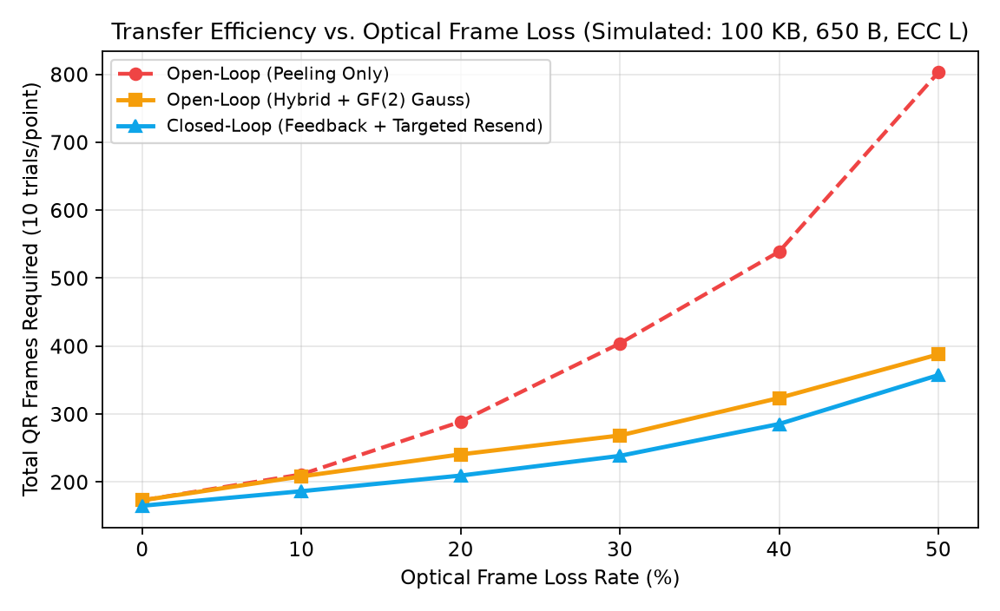
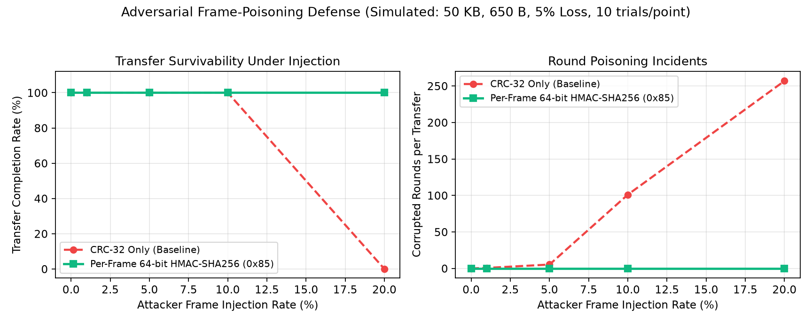
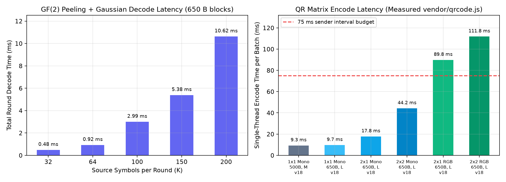
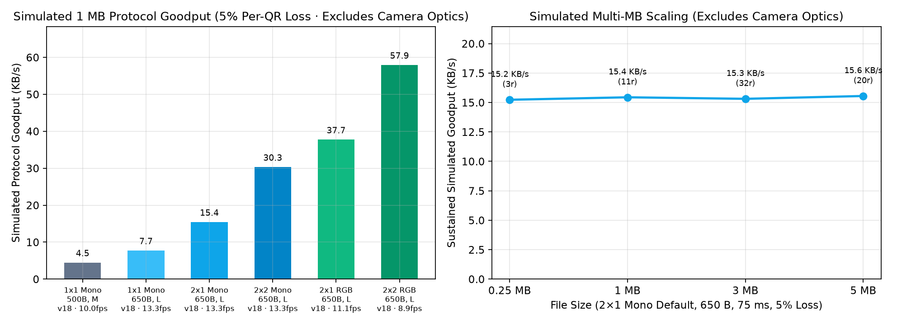

# QR-Stream: Authenticated, Rateless Screen-to-Camera Air-Gapped Data Transfer

> **Paper Blueprint & Quantitative Evaluation Report**  
> Generated directly from `codec.js`, `vendor/qrcode.js`, `tests/benchmark_paper.js`, and `tests/plot_paper.py` (`paper/results.json`) on Node.js `v24.15.0` (`win32 x64`).  
> **Scope Note:** Experiments 1–4 and 6 evaluate the real `codec.js` encoder/decoder over simulated erasure, poisoning, and feedback channels (and therefore exclude real camera optics and browser QR scanner latency). Experiment 5 and the Base45/Base64 comparison report directly measured Node.js execution timings on `codec.js` and `vendor/qrcode.js`.

---

## 1. Positioning & Verified Protocol Properties

**Working Title:** *QR-Stream: Resilient and Authenticated Rateless Optical Data Transfer Across Air-Gapped Devices*

1. **Per-Frame Cryptographic Authentication (`VER_AUTH = 0x85`):** Unauthenticated CRC-32 fountain rounds fail silently or stall under adversarial optical injection: at `20%` forged-frame injection (`50 KB`, `650 B` blocks, `5%` channel loss), the CRC-32 baseline suffers **256.9 corrupted rounds per transfer** and **0% completion**. Appending an **8-byte (64-bit) truncated HMAC-SHA256** tag per frame (`1.19%` wire overhead on a `670 B` block frame, verified in **4.7–4.8 µs** in Node.js) reduces corrupted rounds to **0.0** and maintains **100% completion** across `0%–20%` injection.
2. **Encrypted Metadata Manifest (`T_FILE_ENC = 0x05`):** When a password is set, `codec.js` derives a 256-bit master secret via PBKDF2-HMAC-SHA256 (`600,000` iterations, 128-bit CSPRNG salt), performs domain-separated HMAC-SHA256 key derivation into `aesKey` (`'qr-stream-aes-v5'`) and `macKey` (`'qr-stream-mac-v5'`), and encrypts both the file payload and manifest metadata (`origSize`, `payloadCrc`, `name`, `mime`) with AES-256-GCM.
3. **True Air-Gap (Open-Loop) vs. Hybrid Closed-Loop Recovery:** Combining systematic-first emission, hybrid parity degrees (`2/3` medium-dense `ceil(0.25*K)` + `1/3` Robust Soliton `C=0.03, delta=0.5`), and bit-packed **GF(2) Gaussian elimination** yields **1.078×–1.104×** symbol overhead in network-free open-loop mode across `10%–50%` IID loss—cutting required frames by **51.7%** at `50%` loss (`387.7` vs `802.6` frames) compared to peeling-only LT decoding. With Wi-Fi `/feedback`, closed-loop targeted tail repair reduces symbol overhead to **1.000×–1.044×**.
4. **Spatial & Experimental Color Multiplexing with Real Encoder Accounting:** Current `sender.html` defaults use `2×1` Monochrome (`650 B`, `ECC L`, `75 ms` = `13.33 fps`), fitting each `670 B` frame into QR v18 (`89×89` modules). Measuring `vendor/qrcode.js` shows single-threaded QR matrix generation stays well under the `75 ms` frame budget for monochrome modes (`9.31–44.24 ms`), whereas 6-QR (`2×1 RGB`: `89.81 ms`, `11.13 fps` max) and 12-QR (`2×2 RGB`: `111.83 ms`, `8.94 fps` max) exceed `75 ms` on a single thread.

---

## 2. System Architecture (Matching Current Implementation)

- **Pipeline:** Optional zlib/deflate compression (`flags |= 1`, auto-skipped on pre-compressed extensions or incompressible 16 KB sample) → optional PBKDF2-HMAC-SHA256 (`600k`) + HMAC-SHA256 key separation + AES-256-GCM (`flags |= 6`) → **96 KB rounds** (`256 KB` rounds for payloads `> 4 MB`, up to `1,024` rounds via `doneRounds[]` + 30-bit `doneMask`) → systematic + hybrid LT fountain → CRC-32 + optional 8-byte HMAC-SHA256 (`VER_AUTH = 0x85`) → Base45 (RFC 9285) + QR Alphanumeric mode.
- **Sender (`sender.html`):** Defaults to `2×1 Mono`, `650 B`, `ECC L`, `75 ms`. Renders into a reusable 32-bit `Uint32Array` `ImageData` buffer with a single-slot pre-rendered backbuffer (`schedulePreRender`). Runs a hysteresis multiplicative `RateController` (`1.4×` step, `40–180 ms` bounds: slows after `3` polls `< 0.72` delivery ratio, speeds up after `2` polls `> 0.90`).
- **Receiver (`receiver.html`):** Uses `BarcodeDetector(<video>)` zero-copy hardware decoding when supported, backed by a 3-worker QR-only `zbar.wasm` pool (`maxInFlight = 1`, `requestAnimationFrame`-paced loop, periodic RGB probe only after `12` empty scans).

---

## 3. Verified Quantitative Results

### Table 1: Encoding Efficiency (Measured on Real `670 B` Frame, `ECC L`, `vendor/qrcode.js`)
| Encoding Scheme | QR Mode | Encoded Length | QR Version & Grid | Theoretical Payload Density |
|---|---|---:|---|---:|
| Base64 (Baseline) | Byte (8-bit) | 896 chars | v21 (`101×101`) | 93.75 B / 1,000 bits |
| **Base45 (RFC 9285)** | **Alphanumeric (5.5-bit)** | **1,005 chars** | **v18 (`89×89`)** | **121.21 B / 1,000 bits (+29.3%)** |

### Table 2: Simulated Transfer Efficiency Across IID Loss (`100 KB`, `650 B`, `ECC L`, 10 trials/cell)
| Loss Rate | Open-Loop (Peeling Only) | Open-Loop (Hybrid + GF(2) Gauss) | Closed-Loop (Feedback) | Gauss Frame Savings (Open-Loop) |
|---:|---:|---:|---:|---:|
| 0% | 173.0 fr (1.000×) | 173.0 fr (1.000×) | 165.0 fr (1.000×) | 0.0% |
| 10% | 211.2 fr (1.092×) | 208.2 fr (1.080×) | 186.4 fr (1.025×) | 1.4% |
| 20% | 288.7 fr (1.234×) | 240.6 fr (1.104×) | 209.4 fr (1.016×) | 16.7% |
| 30% | 403.9 fr (1.479×) | 268.4 fr (1.078×) | 238.4 fr (1.024×) | 33.5% |
| 40% | 538.9 fr (1.742×) | 323.6 fr (1.097×) | 285.3 fr (1.032×) | 40.0% |
| 50% | 802.6 fr (2.163×) | 387.7 fr (1.099×) | 357.2 fr (1.044×) | **51.7%** |

### Table 3: Simulated Bursty Channel (Gilbert-Elliott Model, `100 KB`, `650 B`, `ECC L`, 10 trials/cell)
| Mean Loss Rate | Open-Loop (Hybrid + Gauss) | Closed-Loop (Feedback) | Completion Rate |
|---:|---:|---:|---:|
| 10% | 211.9 fr (1.093×) | 184.3 fr (1.006×) | 100% |
| 20% | 248.2 fr (1.094×) | 214.6 fr (1.020×) | 100% |
| 30% | 264.6 fr (1.111×) | 224.6 fr (1.018×) | 100% |
| 40% | 296.6 fr (1.103×) | 254.4 fr (1.029×) | 100% |

### Table 4: Simulated Adversarial Frame Poisoning (`50 KB`, `650 B`, `ECC L`, 5% loss, 10 trials/cell)
| Injection Rate | CRC-32 Completion | CRC-32 Corrupt Rounds/Tx | HMAC-SHA256 Completion | HMAC-SHA256 Corrupt Rounds/Tx | Forged Frames Rejected/Tx |
|---:|---:|---:|---:|---:|---:|
| 0% | 100% | 0.0 | 100% | 0.0 | 0.0 |
| 1% | 100% | 0.7 | 100% | 0.0 | 1.0 |
| 5% | 100% | 5.3 | 100% | 0.0 | 4.8 |
| 10% | 100% | 101.1 | 100% | 0.0 | 8.4 |
| **20%** | **0%** | **256.9** | **100%** | **0.0** | **17.5** |

### Table 5: Simulated Dynamic Channel Adaptation (30s Trace, `2×1 Mono 650 B`, 10s–20s Defocus Burst)
| Policy | Delivery Ratio (Decoded / Sent) | Simulated Goodput |
|---|---:|---:|
| Fixed Default (`75 ms` / `13.33 fps`) | 0.708 (`283 / 400` refreshes) | 11.98 KB/s |
| **Multiplicative `RateController` (`1.4×` step, `40–180 ms`)** | **0.723** | **14.94 KB/s** |

### Table 6: Measured Cryptographic, GF(2), and QR Matrix Encode Benchmarks (Node.js `v24.15.0`)
| File Size | PBKDF2 (600k) + AES-256-GCM Init | Frame Gen + HMAC-SHA256 | Frame Verify HMAC-SHA256 | Base45 Decode |
|---:|---:|---:|---:|---:|
| 10 KB | 93.3 ms | 14.4 µs | 4.8 µs | 0.8 µs |
| 100 KB | 89.1 ms | 12.2 µs | 4.8 µs | 0.9 µs |
| 500 KB | 90.0 ms | 12.9 µs | 4.8 µs | 0.7 µs |
| 1,024 KB | 101.8 ms | 14.4 µs | 4.7 µs | 0.7 µs |

**Measured GF(2) Peeling + Sparse Gaussian Decode Latency vs. `K` (`650 B` blocks):**
`K=32`: **0.48 ms** | `K=64`: **0.92 ms** | `K=100`: **2.99 ms** | `K=150`: **5.38 ms** | `K=200`: **10.62 ms**

**Measured `vendor/qrcode.js` Batch Encode Latency (Alphanumeric mode):**
- `1×1 Mono (500B, M)` — QR v18 (`89×89`): **9.31 ms** (`107.40 fps` ceiling)
- `1×1 Mono (650B, L)` — QR v18 (`89×89`): **9.67 ms** (`103.46 fps` ceiling)
- `2×1 Mono (650B, L)` *(default)* — QR v18 (`89×89`): **17.81 ms** (`56.14 fps` ceiling)
- `2×2 Mono (650B, L)` — QR v18 (`89×89`): **44.24 ms** (`22.60 fps` ceiling)
- `2×1 RGB (650B, L)` — QR v18 (`89×89`): **89.81 ms** (`11.13 fps` ceiling)
- `2×2 RGB (650B, L)` — QR v18 (`89×89`): **111.83 ms** (`8.94 fps` ceiling)

### Table 7: Simulated Protocol Goodput & Multi-MB Scaling (5% Per-QR Loss, Encode-Capped; Excludes Camera Optics)
| Configuration | File Size | Refreshes | Effective FPS | Symbol Overhead | Simulated Time | Simulated Goodput | Byte-Verified |
|---|---:|---:|---:|---:|---:|---:|---|
| `1×1 Mono (500B, M, 10fps)` | 1 MB | 2,286 | 10.00 fps | 1.001× | 228.60 s | 4.48 KB/s | Yes |
| `1×1 Mono (650B, L, 75ms)` | 1 MB | 1,764 | 13.33 fps | 1.005× | 132.33 s | 7.74 KB/s | Yes |
| **`2×1 Mono (650B, L, 75ms)` *(default)*** | **1 MB** | **884** | **13.33 fps** | **1.005×** | **66.32 s** | **15.44 KB/s** | **Yes** |
| `2×2 Mono (650B, L, 75ms)` | 1 MB | 450 | 13.33 fps | 1.002× | 33.76 s | 30.33 KB/s | Yes |
| `2×1 RGB (650B, L, 75ms)` | 1 MB | 302 | 11.13 fps | 1.011× | 27.13 s | 37.74 KB/s | Yes |
| `2×2 RGB (650B, L, 75ms)` | 1 MB | 158 | 8.94 fps | 1.015× | 17.67 s | 57.94 KB/s | Yes |
| `2×1 Mono` Scaling | 0.25 MB (3 rounds) | 224 | 13.33 fps | 1.000× | 16.80 s | 15.23 KB/s | Yes |
| `2×1 Mono` Scaling | 3 MB (32 rounds) | 2,675 | 13.33 fps | 1.006× | 200.68 s | 15.31 KB/s | Yes |
| `2×1 Mono` Scaling | 5 MB (20 rounds) | 4,390 | 13.33 fps | 1.000× | 329.33 s | 15.55 KB/s | Yes |

