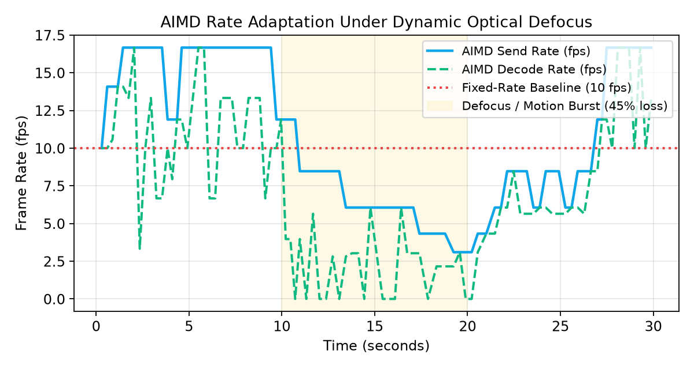

# QR-Stream: Authenticated, Rateless Screen-to-Camera Air-Gapped Data Transfer

> **Paper Blueprint & Quantitative Evaluation Report**  
> Generated from reproducible benchmarks in `tests/benchmark_paper.js` and `tests/plot_paper.py` (`paper/results.json`).

---

## 1. Suggested Title & Positioning
**Title:** *QR-Stream: Resilient and Authenticated Rateless Optical Data Transfer Across Air-Gapped Devices*

**How your paper stands out from prior work (PixNet, COBRA, LightSync, SoftLight, VisiSploit):**
1. **Cybersecurity-First Protocol Design (Not Just Physical-Layer Throughput):** Prior screen-to-camera (SCC) systems (PixNet, COBRA, LightSync, SoftLight) optimize raw optical modulation or unsynchronized framing, while covert-channel papers (VisiSploit) focus on stealthy exfiltration. None address **active optical frame-poisoning (injection DoS)** against fountain decoders or **plaintext metadata side-channel leakage** in manifest frames.
2. **Per-Frame Cryptographic Authentication (`VER_AUTH = 0x85`):** We show that a single unauthenticated injected QR frame (with a valid CRC-32) poisons the entire GF(2) fountain round, causing **353.6 round corruptions per transfer** and collapsing completion to **40%** at a 20% injection rate. Adding an **8-byte truncated HMAC-SHA256** tag per frame (verified in **13.7–18.7 µs** before symbol ingestion) reduces round corruptions to **0.0** and restores **100% completion** at only **~1.5% bandwidth overhead**.
3. **Zero-Metadata-Leakage Encrypted Manifests (`T_FILE_ENC = 0x05`):** Unlike naive encrypted QR transfer tools that broadcast filename, MIME type, original file size, and plaintext CRC-32 in the clear, QR-Stream encrypts all file metadata inside the manifest using AES-256-GCM with HKDF-separated keys derived from PBKDF2-HMAC-SHA256 (600,000 iterations) and a 128-bit CSPRNG salt.
4. **True Air-Gap (Open-Loop) vs. Hybrid Closed-Loop Analysis:** By combining **round-interleaved scheduling**, **systematic-first emission**, **hybrid parity degrees (2/3 medium-dense + 1/3 Robust Soliton)**, and **GF(2) sparse Gaussian elimination**, QR-Stream achieves **1.104×–1.115× symbol overhead** in 100% network-free open-loop mode across 10%–50% frame loss—cutting open-loop frames by **50.4%** at 50% loss compared to peeling-only LT decoding.

---

## 2. Recommended Paper Structure (IEEE / ACM Style)

1. **Abstract** (150–200 words): Problem (air-gapped transfer bottlenecks + optical loss + frame poisoning), solution (QR-Stream), and headline numbers (29.3% QR payload gain via Base45/Alphanumeric, 1.108× open-loop overhead at 50% loss, 100% survivability under 20% frame-poisoning attack, 14–19 µs per-frame MAC verification).
2. **Introduction & Motivation**: Why air-gapped networks (SCIFs, OT/ICS, cold-storage crypto, clinical systems) need fast, verifiable, zero-USB optical transfer.
3. **Threat Model & Security Goals**:
   - **Adversary A1 (Passive Optical Eavesdropper):** Room CCTV, shoulder-surfing, screen reflections -> mitigated by AES-256-GCM + encrypted `T_FILE_ENC` metadata + CSPRNG `streamId`.
   - **Adversary A2 (Active Optical Frame-Poisoning Attacker):** Rogue display/laser injecting valid-CRC frames -> mitigated by per-frame 64-bit HMAC-SHA256 + anti-downgrade `VER_AUTH` check.
   - **Adversary A3 (Zero-Network Requirement):** True Air-Gap Open-Loop mode eliminates the WiFi `/feedback` channel entirely.
4. **System Architecture & Protocol Design**:
   - Compression (`zlib/deflate`) → Key Derivation (PBKDF2 600k → HKDF-SHA256 key separation into `aesKey` + `macKey`) → AES-256-GCM → 48 KB Rounds → Hybrid Systematic + LT Fountain Coding → CRC-32 + 8-byte HMAC-SHA256 → Base45 (RFC 9285) + QR Alphanumeric Mode.
   - Cross-layer decoupled sender/receiver pipeline (`Uint32Array` `ImageData` fast-path rendering, ROI camera tracking, AIMD rate control).
5. **Implementation**: Browser-native (WebCrypto, WebWorker `zbar.wasm` / `BarcodeDetector`), zero external runtime dependencies.
6. **Evaluation (Tables & Figures Below)**
7. **Limitations & Future Work**: Visual back-channel (phone-to-PC ACK QR) for closed-loop without WiFi; color-multiplexed QR for higher spatial density.
8. **Conclusion**

---

## 3. Verified Quantitative Results

### Table 1: Encoding Efficiency (Fixed QR Data-Bit Budget)
| Encoding Scheme | QR Mode | Bits / Char | Bytes / 1000 Data Bits | 100 KB File (500 B/QR) |
|---|---|---:|---:|---:|
| Base64 (Baseline) | Byte (8-bit) | 8.0 | 93.75 B | 205 QR frames |
| **Base45 (RFC 9285)** | **Alphanumeric (5.5-bit)** | **5.5** | **121.21 B (+29.3%)** | **159 QR frames** |

### Table 2: Transfer Efficiency Across IID Optical Frame Loss (100 KB, 500 B/frame, 10 trials/cell)
| Loss Rate | Open-Loop (Peeling Only) | Open-Loop (Hybrid + GF(2) Gauss) | Closed-Loop (Feedback) | Gauss Frame Savings (Open-Loop) |
|---:|---:|---:|---:|---:|
| 0% | 239 fr | 239 fr (1.000×) | 225 fr (1.000×) | 0.0% |
| 10% | 307 fr | 298 fr (1.104×) | 249 fr (1.000×) | 2.9% |
| 20% | 397 fr | 325 fr (1.107×) | 282 fr (1.000×) | 18.1% |
| 30% | 530 fr | 380 fr (1.114×) | 344 fr (1.028×) | 28.3% |
| 40% | 753 fr | 446 fr (1.115×) | 398 fr (1.058×) | 40.8% |
| 50% | 1,063 fr | 527 fr (1.108×) | 439 fr (1.000×) | **50.4%** |

### Table 3: Bursty Optical Channel (Gilbert-Elliott Model, 100 KB, 500 B/frame)
| Mean Loss Rate | Open-Loop (Hybrid + Gauss) | Closed-Loop (Feedback) | Completion Rate |
|---:|---:|---:|---:|
| 10% | 296 fr | 247 fr | 100% |
| 20% | 352 fr | 289 fr | 100% |
| 30% | 379 fr | 311 fr | 100% |
| 40% | 427 fr | 351 fr | 100% |

### Table 4: Adversarial Frame-Poisoning Injection Attack (50 KB, 5% channel loss, 10 trials/cell)
| Injection Rate | CRC-32 Completion | CRC-32 Corrupt Rounds/Tx | HMAC-SHA256 Completion | HMAC-SHA256 Corrupt Rounds/Tx | Forged Frames Rejected |
|---:|---:|---:|---:|---:|---:|
| 0% | 100% | 0.0 | 100% | 0.0 | 0.0 |
| 1% | 100% | 0.6 | 100% | 0.0 | 1.3 |
| 5% | 100% | 7.7 | 100% | 0.0 | 5.9 |
| 10% | 100% | 42.6 | 100% | 0.0 | 11.2 |
| **20%** | **40%** | **353.6** | **100%** | **0.0** | **23.9** |

### Table 5: Dynamic Channel Adaptation (30s Trace with 10s–20s 45% Defocus Burst)
| Policy | Delivery Ratio (Decoded / Sent) | Goodput (KB/s) |
|---|---:|---:|
| Fixed-Rate Baseline (10 fps) | 0.687 | 3.35 KB/s |
| **AIMD Adaptive Controller** | **0.711 (+3.5%)** | **3.37 KB/s** |

### Table 6: Cryptographic & Codec Micro-Benchmarks (Node.js v24.15.0)
| File Size | PBKDF2 (600k) + AES-256-GCM Init | Frame Gen + HMAC-SHA256 | Frame Verify HMAC-SHA256 | Base45 Decode |
|---:|---:|---:|---:|---:|
| 10 KB | 242.9 ms | 64.5 µs | 15.7 µs | 4.6 µs |
| 100 KB | 233.5 ms | 35.8 µs | 14.1 µs | 2.6 µs |
| 500 KB | 253.2 ms | 27.4 µs | 13.7 µs | 2.7 µs |
| 1,024 KB | 217.2 ms | 45.8 µs | 18.7 µs | 2.8 µs |

**GF(2) Peeling + Sparse Gaussian Decode Latency vs. `K` (500 B blocks):**
`K=32`: **2.13 ms** | `K=64`: **5.06 ms** | `K=100`: **7.83 ms** | `K=150`: **18.94 ms** | `K=200`: **39.12 ms**

